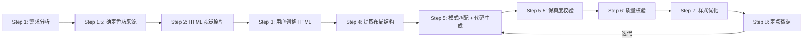

# Qt Widget UI 设计器 + 样式优化 Skill

## 核心功能

1. **HTML 视觉原型** — 用 HTML/CSS 快速表达布局，浏览器即时预览
2. **设计模式库** — 8 种核心 UI 模式，覆盖常见场景
3. **规范代码生成** — HTML 布局 + Qt 模式 → 符合架构规范的 C++ 代码
4. **QSS 样式系统** — 主题管理器、深色/浅色主题、自定义控件样式
5. **动画效果** — 属性动画、过渡效果、高 DPI 适配
6. **质量校验** — 生成后按清单自查
7. **定点微调** — 最小改动原则，精准调整

## When NOT to use

本 Skill 不适用以下场景：

- 项目要求沿用 Qt Designer `.ui` 文件并直接加载，不走纯代码 UI 流程。
- 需要复杂 3D、图表或 Web 内容（考虑 QML / Qt Quick / WebEngine）。
- **只改已有 C++ 代码里的一处颜色/间距/尺寸**（不新建 UI、不需要原型评审）→ 直接走 Step 8 定点微调，
  不必重跑 Step 1–7。注意边界：**一旦用本 Skill 新建或重构 UI，Step 2 的 HTML 原型不可跳过**
  （包括"赶 deadline"的情形，见 evals id=1）。

## 工作流程



### Step 1: 需求分析

识别以下信息：
- **组件类型**：对话框 / 面板 / 主窗口 / 自定义控件
- **功能需求**：需要哪些控件、数据输入输出
- **布局约束**：是否需要侧边栏、是否可调整大小、是否需要滚动
- **样式需求**：是否需要主题切换、深色/浅色模式、动画效果

向用户确认组件类型和关键约束，再进入下一步。

### Step 1.5: 确定色板来源（Step 2 的前置条件）

HTML 原型必须使用与最终 Qt 代码**完全一致**的颜色，所以生成原型前先确定色值来源，
按 `references/theme-manager.md` 第 1 节的三分支处理：

1. **项目已有 ThemeManager**（或等价色板定义）→ 读取其 `LoadTheme()` / 色板表，项目色板优先。
2. **项目没有 ThemeManager**（新项目 / 空目录）→ 先用 `theme-manager.md` 第 3 节的实现
   Bootstrap 一个 ThemeManager，再以它的 `LoadTheme()` 为色值来源。**不要因为"读不到文件"就跳过本步，
   更不要在原型里凭感觉写色值。**
3. **用户自带品牌色板** → 用用户色板覆盖同名 key，其余沿用默认色板，写入 `LoadTheme()` 后再生成原型。

`references/theme-manager.md` 第 2 节是全 Skill 的**唯一权威色板表**；
`themes/modern-*.qss` 是它的静态展开快照，二者同源。任何示例都不得引入第二套设计系统色值。

### Step 2: 生成 HTML 视觉原型

**前置条件：Step 1.5 已完成，色值来源已确定**，确保 HTML 原型使用与 Qt 代码完全一致的颜色。

根据需求生成 HTML/CSS 原型页面，遵循以下约束：

#### 原型可还原性原则

HTML 原型的唯一目标是**指导 Qt Widget 实现**。生成每个元素、每行样式前，先确认：**这个效果在 QWidget + QSS + 标准布局中能否被高度一致地还原？**

- 如果 CSS 属性或 HTML 特性在 Qt 中**无法直接实现**（如 `box-shadow`、`text-shadow`、`opacity`、`linear-gradient`），则**禁止在 HTML 原型中使用**；若需自定义 `paintEvent()`、事件过滤器、`QGraphicsEffect`、平台代码或第三方库，视为**实现成本过高**，必须改用 Qt 可实现的替代方案。（唯一例外：Step 7.3 的阴影增强，需用户在 Step 3 明确确认、不体现在原型中、也不计入还原度校验。）
- 原型中的颜色、间距、圆角、边框、字号、布局比例，必须与最终 Qt 代码中的 `ThemeManager`、QSS、`setContentsMargins()`、`setSpacing()`、`setMinimumSize()` 等保持一一对应。
- 原型阶段就要模拟 QWidget 的渲染特征：无 CSS 动画/过渡、无复杂层叠、无 Web 专属特效、控件层级由布局顺序决定。

> 详细禁用清单与替代方案见 `references/html-prototype-guide.md`。

#### 布局约束

1. **只用 flexbox/grid 基础布局**，不用 `float` / `position: absolute`。
2. **只用语义化标签**，避免无意义 div 嵌套。
3. **用 HTML 注释标注 Qt 特殊控件**（完整清单见 `references/html-qt-mapping.md` 第 4 章）：
   - `<!-- dock: left/right/top/bottom -->` → QDockWidget
   - `<!-- splitter -->` → QSplitter
   - `<!-- tab-container -->` → QTabWidget
   - `<!-- stacked: page1, page2 -->` → QStackedWidget
   - `<!-- toolbar -->` → QToolBar
   - `<!-- statusbar -->` → QStatusBar
   - `<!-- menubar -->` → QMenuBar
4. **不用 CSS 动画/过渡**，动画在 Qt 中用 `QPropertyAnimation` 实现。
5. **允许基础交互 JavaScript** 用于原型演示（Tab 切换、按钮状态、列表选中、模态框等），但不映射到 Qt 代码。详见 `references/html-prototype-guide.md` 第 6 章。

#### 颜色约束

必须用 Step 1.5 确定的色板生成 CSS 变量，**变量名 = `ThemeManager::ThemeColor()` 的 key**，
值与当前主题下 `ThemeManager` 的实际输出逐字一致。变量名清单与两套主题的具体色值见
`references/theme-manager.md` 第 2、4 节（唯一权威色板表），此处不复制色值，避免多份事实源漂移。

- ❌ 禁止从 Material Design / Tailwind 等第三方设计系统临时抓色值填入原型；
  禁止凭感觉猜色；禁止 HTML、QSS、C++ 三处出现不一致的字面量。
- ✅ 项目自有色板优先；无自有色板时使用 `theme-manager.md` 的默认色板，且先落地 ThemeManager。

#### QWidget 风格约束核心原则

HTML 原型必须模拟 QWidget 的渲染特征：

- **每个效果都必须在 QWidget 中有对应实现方案**；否则禁止在 HTML 原型中使用。
- **禁用 CSS 特效**：`box-shadow`、`text-shadow`、`backdrop-filter`、`border-image`、`opacity`、`transform`、`transition/animation`、`filter`、`clip-path`。
- **禁用 Web 布局/层叠特性**：`position: absolute/fixed`、`float`、`z-index`、`::before/::after` 伪元素、复杂 CSS Grid。
- **禁用渐变**：`linear-gradient` / `radial-gradient`，用纯色替代。
- **圆角规则**：推荐 `≤6px`；按钮主操作和卡片容器可放宽至 `8px`，避免 `>12px`。
- **交互态（`:hover` / `.active` / `[selected]`）**：允许用它们表达**静态**交互态预览，
  但禁止搭配 `transition` / 缩放 / 阴影做动画；每处必须标注 `<!-- hover-state -->` 或
  `<!-- state: selected -->`。Qt 侧对应 `setAttribute(Qt::WA_Hover)` + QSS 伪状态，
  或 `Q_PROPERTY` + 属性选择器（见 `references/html-qt-fidelity.md` 第 2、3 章）。
  **主题 qss 与保真度规则里的 `:hover` 是 Qt 侧实现，与此处并不冲突。**
- **`outline` 规则**：不要用 CSS `outline` 画焦点框或装饰线——QSS 只支持 `outline: none`
  清除焦点矩形，不支持自定义 outline 样式（两份主题 qss 正是这么用的）。焦点态用
  QSS `:focus` + `border` 表达。
- **SVG 规则（两个概念，不要混为一谈）**：
  - **QSS data URI SVG**：仅全局主题文件允许用于 `QCheckBox` / `QRadioButton` 的
    indicator；运行时动态 `setStyleSheet()` 中禁用（解析开销大、易失效）。
  - **图标资源**：HTML 原型用 Unicode / 文字占位（不用内联 SVG、不用 icon font）；
    Qt 侧**允许且推荐** `QIcon(QStringLiteral(":/icons/search.svg"))`（QtSvg 标准做法，
    高 DPI 友好），与 QSS data URI 是两回事，不受上一条限制。
- **边框用实线**：只用 `border: 1px solid #color`，不用虚线/双线/圆角渐变边框。
- **颜色用纯色**，**字体用系统字体**（`Segoe UI`、`Microsoft YaHei` 等），**间距用像素值**（8/12/16px）。
- **模拟 QWidget 尺寸策略**：输入框宽度用 `flex:1` 而非 `width:100%`，按钮用 `min-width` 而非 `width`。
- **特殊效果用注释标注**：`<!-- scroll-area -->`、`<!-- scaled-contents -->`、`<!-- elided-label -->`、`<!-- splitter -->`。

转换时 CSS 变量必须替换为 `ThemeManager::ThemeColor(key).name()` 的实际值，QSS 不支持变量。

> 详细对照表见 `references/html-prototype-guide.md`。

### Step 3: 用户调整 HTML

用户在浏览器中查看原型，提出调整意见。AI 按以下方式处理：

- 布局调整 → 修改 flex 方向/比例
- 尺寸调整 → 修改 width/height/flex
- 增删元素 → 添加/移除 HTML 元素
- 间距调整 → 修改 gap/padding/margin

**迭代直到用户对布局满意。**

### Step 4: 提取布局结构

从 HTML 中提取布局信息：
- 布局方向（垂直/水平/网格/表单）
- 比例关系（flex 值 → stretch factor）
- 分组关系（card → QGroupBox, nav+main → QSplitter）
- 特殊控件标注（dock/splitter/tab/stacked/toolbar）

> 详见 `references/html-qt-mapping.md`

### Step 5: 模式匹配 + 代码生成

1. 根据组件类型和布局结构，从模式库中选择最匹配的设计模式
2. 结合 HTML 布局信息和模式模板，生成 C++ 代码

**代码生成约定**：
- 头文件守卫用 `#pragma once`
- 类命名：XxxDialog / XxxPanel / XxxWidget
- 成员变量：`snake_case_` 尾下划线（与 qt-widget-architecture 规范一致）
- UI 初始化放在 `setupUi()` 私有方法中
- 信号槽连接放在 `connectSignals()` 私有方法中
- 使用新式 connect 语法
- 不混合业务逻辑——UI 类只管布局和交互转发

**子组件映射核心原则**：

- 逐元素扫描 HTML 原型，每个视觉元素都必须映射到对应的 Qt 控件和 QSS 规则。
- 样式属性（background、color、border、border-radius、font、padding、margin、gap、尺寸）需完整映射到 QSS 或布局参数。
- 复合控件内部每个子元素、滚动条、圆角容器子控件配合、QFrame 边框统一等细节，按 `references/html-qt-mapping.md` 执行。

**QWidget 最佳实践核心原则**：

- **样式表性能**：优先使用 `#objectName` 选择器；在根容器集中设置；避免在循环或运行时频繁调用 `setStyleSheet()`。
- **布局性能**：布局嵌套不超过 3 层；始终使用布局管理器；`QScrollArea` 必须 `setWidgetResizable(true)`。
- **控件选择**：只读文本用 QLabel；简单输入用 QLineEdit；静态列表用 QListWidget。
- **内存与信号槽**：控件指定 parent 或加入布局；避免信号循环；批量更新时用 `blockSignals(true/false)`。

> 完整规则与模板见 `references/html-qt-mapping.md` 和 `references/widget-patterns.md`

### Step 5.5: 保真度校验（HTML → Qt 视觉一致性）

代码生成后、质量校验前，逐项检查 HTML 原型与 Qt 代码的视觉一致性，防止“原型好看但 Qt 渲染走样”。
规则正文共 **12 条**（`references/html-qt-fidelity.md`），落到自查清单是
**10 个勾选项**（`references/quality-checklist.md` 第 9 节），快速对照表另有 14 行示例——
三者是「规则 / 勾选项 / 速查」的不同视图，出现新规则时须同步更新，不要写死旧数字。
覆盖布局边距、`:hover`/`WA_Hover`、属性选择器、`QLabel` 小元素尺寸、分隔线、颜色来源、
背景色、字号、复合控件子组件、容器边框配合等。

### Step 6: 质量校验

生成代码后分两层校验：

1. **自动静态扫描**（先跑）：
   `python scripts/check_ui.py <HTML原型> <Qt源码目录或文件...>`，
   检查 HTML 禁用特效、C++ 硬编码色值 / `setFixedWidth` / 运行时 `setStyleSheet` /
   `SLOT`·`SIGNAL` 宏等可机械判定的违例；有 `ERROR` 必须先修完再继续。
2. **人工逐项自查**：按 `references/quality-checklist.md` 覆盖布局合理性、模式一致性、
   代码质量（`setupUi()`/`connectSignals()` 分离、无业务逻辑、命名规范、新式 connect）、
   可维护性、样式质量与 HTML → Qt 保真度。定点微调后只校验第 11 节列出的受影响项。

### Step 7: 样式优化

代码生成后，根据用户的样式需求进行视觉优化。

#### 7.1 主题系统

当项目需要深色/浅色主题切换时，落地 ThemeManager 单例。**完整可编译实现**（头文件 +
`.cpp`，含 `LoadTheme()` 色板定义、系统主题跟随、静态快照 / 动态注入两种加载模式）见
`references/theme-manager.md` 第 3 节。按 Step 1.5，它在生成 HTML 原型**之前**就应就位，
不要等到本步才建。

色板的**唯一事实源**是 `references/theme-manager.md` 第 2 节。下表只列最常用的 8 个 key
（完整 20 个见该文件），数值与 `themes/modern-*.qss` 静态快照逐项一致：

| key | 浅色 | 深色 |
|-----|------|------|
| primary | #6200EE | #BB86FC |
| secondary | #03DAC6 | #03DAC6 |
| background | #FAFAFA | #121212 |
| surface | #FFFFFF | #1E1E1E |
| on_background | #212121 | #FFFFFF |
| on_primary | #FFFFFF | #000000 |
| border | #E0E0E0 | #333333 |
| error | #B00020 | #CF6679 |

> `themes/*.qss` 里的硬编码色值只是该色板的**静态展开快照**；运行时改色应通过
> `ThemeManager::LoadTheme()` + qss 中的 `%key%` 占位符动态注入，不要在组件里硬编码色值。
> 完整主题文件见 `references/themes/modern-dark.qss` 和 `references/themes/modern-light.qss`。

#### 7.2 QSS 样式编写

样式表编写遵循以下规则：

1. **选择器语法**（QSS 只有下面这些形式；**没有 `QObject::className` 这种写法**，
   `::` 在 QSS 中是子控件，如 `QComboBox::drop-down`）：
   - `QPushButton` 类型选择器 —— 匹配该类及其子类，**全局主题 qss 必然使用它**
   - `.QPushButton` 精确类选择器 —— 点号前缀只匹配该类、不匹配子类（不是 CSS 的 class 属性）
   - `#okButton` / `QPushButton#okButton` ID 选择器 —— 最具体，组件局部样式首选
   - `QPushButton[flat="true"]` 属性选择器、`QDialog QPushButton` 后代 / `>` 子选择器
   - 特异性：`#id` > `[prop]` / 伪状态 > `.Class` > `Type`，冲突时更具体的胜出
2. **区分两种作用域**：全局主题 qss 在 `qApp->setStyleSheet()` 一次性加载、允许类型选择器；
   组件局部 qss 在根容器 `setupUi()` 中一次性设置、优先 `#objectName` 并避免长后代链。
   两条规则不矛盾——一刀切地禁止类型选择器会让全局主题无法编写。
3. **运行时切换**：用 `setProperty()` + `style()->unpolish()/polish()` 而非重新 `setStyleSheet()`；
   整主题切换由 ThemeManager 统一重建一次全局样式表。
4. **性能禁忌**：不在循环 / 高频回调中 `setStyleSheet()`、不用 QSS 渐变、
   不在运行时 qss 里塞 SVG data URI（仅全局主题的 checkbox/radio indicator 例外）。

```cpp
// ✅ 组件局部样式：#objectName + 根容器一次性设置，色值全部来自 ThemeManager
void StatusPanel::setupUi() {
    setObjectName("statusPanel");
    auto* tm = ThemeManager::Instance();
    static const QString kStyle = QStringLiteral(R"(
        #statusPanel { background-color: %1; }
        #fieldLabel  { color: %2; font-size: 12px; }
        #valueLabel  { color: %3; font-size: 20px; font-weight: bold; }
    )");
    setStyleSheet(kStyle.arg(tm->SurfaceColor().name(),
                             tm->ThemeColor(QStringLiteral("on_surface_secondary")).name(),
                             tm->ThemeColor(QStringLiteral("on_surface")).name()));
}

// ✅ 运行时样式切换：不重建样式表
void StatusPanel::UpdateStatus(bool running) {
    auto* label = value_labels_["status"];
    label->setProperty("statusClass", running ? "running" : "stopped");
    label->style()->unpolish(label);
    label->style()->polish(label);
}
```

> 完整 QSS 属性参考见 `references/qss-reference.md`。`statusClass` 需是已注册的动态属性
> （自定义类建议用 `Q_PROPERTY` 声明），见 `references/html-qt-fidelity.md` 第 3 章。

#### 7.3 自定义控件样式

当标准 QSS 无法满足视觉需求时，通过 `paintEvent()` 自定义绘制。

> **与 Step 2 的边界**：HTML 原型里**禁止**出现 `box-shadow` 等阴影效果（QSS 无法实现，
> 见 `references/html-prototype-guide.md` 第 1 节）。下面两种是 **Qt 侧的增强实现**：
> 只有当用户在 Step 3 明确要求层次感、且接受"原型不体现阴影"时才加入，
> 并且不计入 Step 5.5 的原型还原度校验。默认做法仍是**用纯色 + border 差异表达层次**，
> 保持原型与 Qt 一一对应。
>
> **阴影实现方式选择**（确认确实需要后才用）：
> - **QPainter 手绘**（推荐）：性能好，完全控制渲染，适合大量卡片场景
> - **QGraphicsDropShadowEffect**：实现简单，但性能开销较大，适合少量卡片或静态布局

```cpp
// ui/widgets/CardWidget.h
class CardWidget : public QFrame {
    Q_OBJECT
    Q_PROPERTY(int elevation READ Elevation WRITE SetElevation)
public:
    explicit CardWidget(QWidget* parent = nullptr);
    int Elevation() const { return elevation_; }
    void SetElevation(int elevation);
protected:
    void paintEvent(QPaintEvent* event) override;
private:
    int elevation_ = 1;
};
```

```cpp
// ui/widgets/CardWidget.cpp
void CardWidget::paintEvent(QPaintEvent* event) {
    QPainter painter(this);
    painter.setRenderHint(QPainter::Antialiasing);
    if (elevation_ > 0) {
        QColor shadow_color(0, 0, 0, 30 + elevation_ * 10);
        painter.setPen(Qt::NoPen);
        painter.setBrush(shadow_color);
        painter.drawRoundedRect(rect().adjusted(2, 2, -2, -2), 8, 8);
    }
    painter.setBrush(ThemeManager::Instance()->SurfaceColor());
    painter.setPen(QPen(ThemeManager::Instance()->ThemeColor("divider"), 1));
    painter.drawRoundedRect(rect().adjusted(0, 0, -4, -4), 8, 8);
}
```

> 更多自定义控件样式见 `references/custom-widgets.md`

#### 7.4 动画效果

使用 `QPropertyAnimation` 实现动画，**不用 CSS 动画/过渡**。动画工具类的**完整声明与实现**
（含 `QEasingCurve` 参数、淡入淡出、滑动、缩放、组合动画）**以
`references/animation-patterns.md` 第 1 节为唯一事实源**；本文件不复制声明，避免两处签名漂移。

**动画使用原则**：
1. 动画持续时间 200-400ms，不超过 500ms
2. 使用 `QEasingCurve::InOutQuad` 缓动曲线
3. 动画对象用 `DeleteWhenStopped` 自管理生命周期或指定 parent；**不要把已自释放的
   `QPropertyAnimation*` 返回给调用方持有**（悬空指针），详见 animation-patterns.md 第 1 节
4. 不在动画回调中做耗时操作

> 完整动画模式库见 `references/animation-patterns.md`

#### 7.5 高 DPI 适配

Qt 5 项目需在 `main()` 中启用 `Qt::AA_EnableHighDpiScaling`（Qt 5.6+，且必须早于
`QApplication` 构造）；Qt 6 默认开启高 DPI 缩放，该属性已无作用：

```cpp
#if QT_VERSION < QT_VERSION_CHECK(6, 0, 0)
    QApplication::setAttribute(Qt::AA_EnableHighDpiScaling);
    QApplication::setAttribute(Qt::AA_UseHighDpiPixmaps);
#endif
```

**高 DPI 注意事项**：
1. **图标优先用 SVG 资源**（`QIcon(":/icons/x.svg")`，QtSvg，天然缩放清晰）；位图图标
   再提供 `@2x` / `@3x` 版本。这与「QSS data URI SVG 仅全局主题 indicator 可用」是两条独立规则。
2. 不用固定像素尺寸，用 `minimumSize` + `sizePolicy`。
3. **不要假设 QSS 的 `px` 一定会自动缩放**：Qt 5 / Qt 6 在不同平台与渲染后端上行为并不一致，
   `pt`（物理尺寸）与 `px`（像素）混用会导致字号正常但 padding / 边框偏小。同一份样式表
   **统一用一种单位**，并在 125% / 150% / 200% 缩放下实测；确需精确控制时按
   `devicePixelRatioF()` 换算，或改用 `em` / `QFontMetrics` 计算。`themes/*.qss` 中
   `font-size: 10pt` 与 `padding: 10px` 混用是已知的复核点。
4. 自定义 `paintEvent()` 中使用 `devicePixelRatioF()` 处理位图，用 qreal 版 QPainter API。

### Step 8: 定点微调

用户对 C++ 代码提出调整意见时，按以下流程处理：

1. **解析反馈**：判断属于哪类调整
2. **定位代码**：找到需要修改的成员变量和 `setupUi()` 中的对应代码行
3. **制定改动方案**：列出需要修改的具体位置和内容（不超过 3 处）
4. **执行修改**：用 Edit 工具定点修改，不重写整个文件
5. **局部校验**：只校验受影响的校验项
6. **简要说明**：告诉用户改了什么、为什么这样改

**调整类型**：

| 调整类型 | 调整策略 |
|---------|---------|
| 布局调整 | 修改 stretch/调换控件顺序/更换布局类型 |
| 尺寸调整 | 修改 minimumSize/sizePolicy/stretch |
| 增删控件 | insertWidget/removeWidget |
| 控件替换 | 替换控件类型，保持布局位置和信号不变 |
| 间距调整 | 修改 spacing/contentsMargins/addStretch |
| 结构重组 | 提取子 Widget/包裹 QGroupBox |
| 样式调整 | 修改 QSS 属性/切换 property class/调整 ThemeManager 色板 |
| 动画调整 | 修改 duration/easing curve/添加或移除动画 |

**调整原则**：最小改动、定位精准、校验局部（先重跑 `scripts/check_ui.py`，再按第 11 节校验受影响项）

**迭代终止**：用户满意 / 用户提出新需求 / 超过 5 轮（建议重新审视需求）

---

## 与其他 Skills 的协作

- 生成 UI 代码时遵循 **qt-widget-architecture** 的分层规范（UI 类不包含业务逻辑），
  以及其 `../qt-widget-architecture/references/cmake-patterns.md` 的构建约定：本 Skill 的自定义控件模板都带 `Q_OBJECT`，
  CMake 必须 `set(CMAKE_AUTOMOC ON)`，否则会链接报 `undefined reference to vtable`。
- **qt-widget-architecture** 的 `../qt-widget-architecture/references/naming-conventions.md` 是命名规范的事实源
  （类 / 函数 PascalCase、成员变量 `snake_case_`、文件名 snake_case），本 Skill 与其一致。
- 本仓库当前只有 `qt-widget-architecture`、`cross-agent-bus` 和本 Skill；不引用尚不存在的
  样式优化 / 代码审查 Skill。需要代码审查时按通用 C++ 审查流程处理。

### 本 Skill 内部的事实源约定

新增或修改规则时，先确定它属于下面哪一类，**只改事实源，其余文件改成引用**：

| 内容 | 唯一事实源 | 其他文件的角色 |
|------|-----------|--------------|
| 色板 / ThemeManager 实现 | `references/theme-manager.md` | 只引用，不复制色值 |
| 保真度规则正文 | `references/html-qt-fidelity.md` | `html-qt-mapping.md` 第 11 章是索引；`quality-checklist.md` 第 9 节是勾选项视图 |
| 动画工具类声明 / 实现 | `references/animation-patterns.md` | SKILL.md 只给使用原则 |
| 布局间距 / 尺寸规范 | `references/layout-rules.md` | `html-prototype-guide.md` 的 CSS 变量是其映射 |
| 控件 / 窗口代码模板 | `references/*-templates.md` | SKILL.md 只给代码生成约定 |

---

## 参考资源

| 主题 | 参考文件 |
|------|----------|
| **权威色板 + ThemeManager 实现**（Step 1.5 / 7.1） | `references/theme-manager.md` |
| **自动静态校验脚本**（Step 6 / 8） | `scripts/check_ui.py` |
| HTML→Qt 保真度规则 | `references/html-qt-fidelity.md` |
| HTML 原型指南 | `references/html-prototype-guide.md` |
| HTML→Qt 映射 | `references/html-qt-mapping.md` |
| 布局规则 | `references/layout-rules.md` |
| 控件模式 | `references/widget-patterns.md` |
| 对话框模板 | `references/dialog-templates.md` |
| 面板模板 | `references/panel-templates.md` |
| 主窗口模板 | `references/mainwindow-templates.md` |
| 自定义控件模板 | `references/custom-widget-templates.md` |
| 质量校验清单 | `references/quality-checklist.md` |
| QSS 属性参考 | `references/qss-reference.md` |
| 自定义控件样式 | `references/custom-widgets.md` |
| 动画模式库 | `references/animation-patterns.md` |
| 深色主题 | `references/themes/modern-dark.qss` |
| 浅色主题 | `references/themes/modern-light.qss` |
